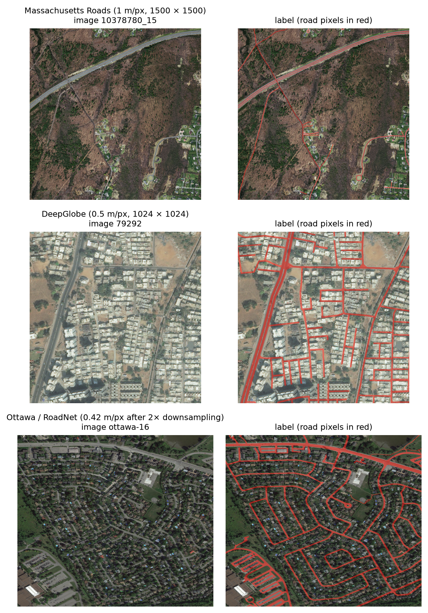
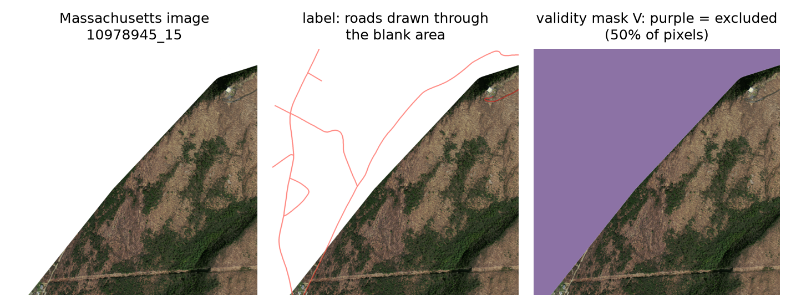
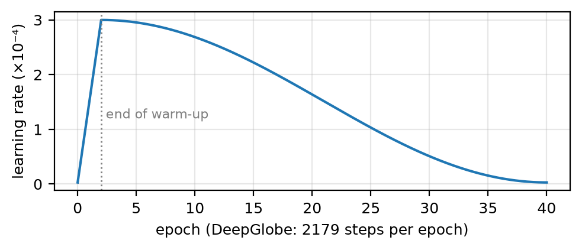
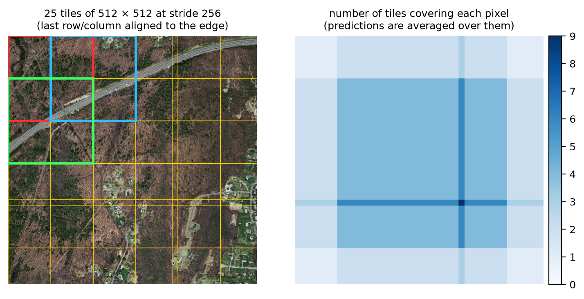
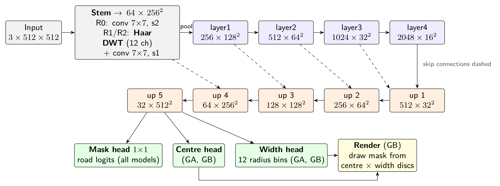
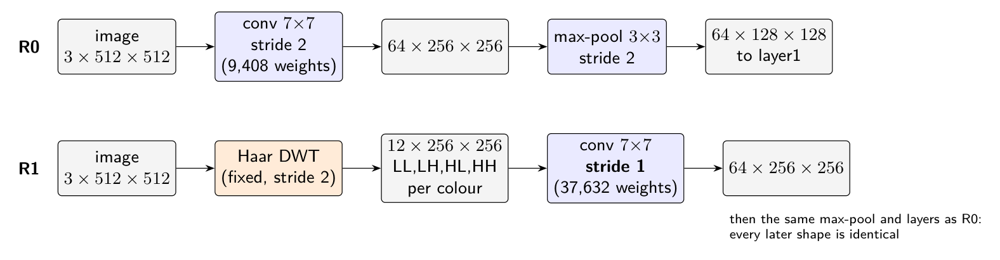
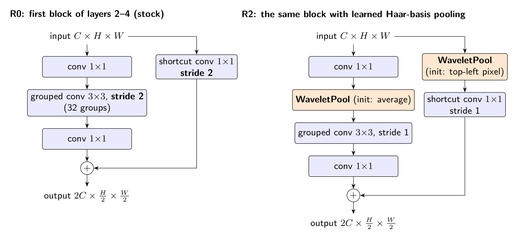
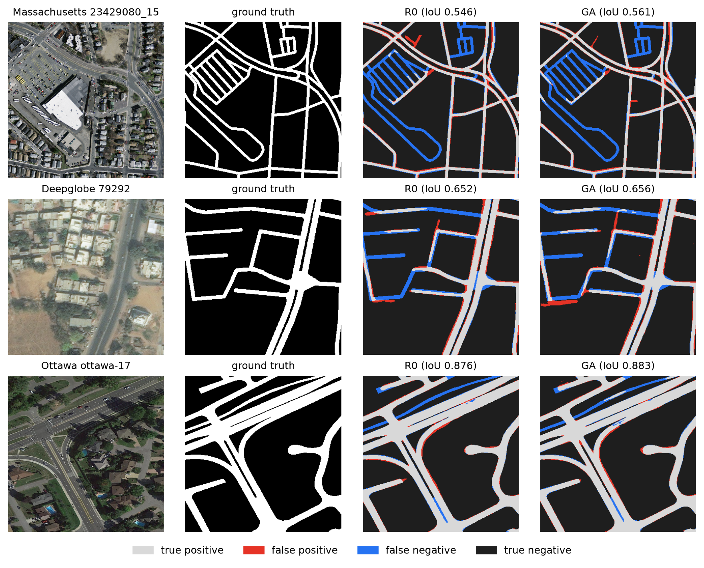

# Abstract {-}

Road extraction from aerial and satellite images is commonly improved by adding structure to a segmentation network. Two kinds of structure are tested here: a frequency-domain front end (a Haar discrete wavelet transform, DWT) and a geometric description of roads (a centre-line and a width). Each is tested under controlled conditions: every variant shares the same ImageNet-pretrained ResNeXt-50 U-Net, data stream, training recipe and seeds, and the primary comparison and its decision rule are fixed in the code repository before any test score is read.

**DWT front end.** We give an exact, function-preserving initialisation of a DWT-input stem from pretrained weights and show that a DWT followed by a convolution is a re-parameterised strided convolution. Consistent with this, the DWT front end makes no detectable difference in per-image test IoU on Massachusetts Roads (+0.0004, 95% CI −0.0040 to +0.0060) or DeepGlobe (+0.0017, −0.0018 to +0.0059). Learned wavelet pooling throughout the network and a clDice topology loss also show no confirmed effect.

**Centre-line and width supervision.** We encode each road label losslessly as centre pixels with disc radii, and add these as auxiliary targets (GA). GA improves DeepGlobe IoU by +0.0073 (95% CI +0.0033 to +0.0118; confirmatory) to 0.6858, and outperforms the Deep-Distance-Transform targets of prior work by +0.0046 (pre-specified). The gain needs both the centre and the width terms and comes from fewer false positives. It does not replicate on Massachusetts Roads (+0.0027, five seeds) or on a third dataset, Ottawa (−0.0029, five seeds). Drawing the mask from the predicted geometry (GB), or feeding the geometry back into the decoder (GFa), gives no confirmed gain.

On DeepGlobe, GA's road IoU is above every published result we compared against except one, which it matches. Because those papers use different splits and protocols, the controlled comparisons are the evidence that matters.

# How to read this document {-}

::: {custom-style="Explainer"}
**Shaded boxes like this one are explanations written for learning and for checking the work.** They walk through each step with concrete numbers and examples. Everything outside the boxes is written as paper text. To turn this document into a paper, delete the shaded boxes (Word: Home → Styles → right-click "Explainer" → Select All Instances → Delete), then shorten the method sections as the venue requires.
:::

The document covers three studies run on one code base:

| Study | Question | Models | Datasets | Seeds |
|:----------------|:-------------------------------------------|:---------------------|:-----------------|:-------:|
| 1. Wavelets | Does a Haar DWT front end (the draft paper's method) or wavelet pooling help a pretrained ResNeXt? | R0, R1, R2, R3, U-Net, D-LinkNet | Massachusetts, DeepGlobe | 3 |
| 2. Geometric targets | Does supervising the road's centre-line and width help? Which part of the target matters, and is it better than prior targets? | GA, GB, GAc, GAw, GD, GO | Massachusetts, DeepGlobe, Ottawa | 3–5 |
| 3. Geometry feedback | Does feeding predicted geometry back into the decoder help further? | GFa, GFb | all three | 1–3 |

Table: Table 1. The three studies. R0 is the common control for all of them.

# Introduction

Road maps derived from aerial and satellite images are used for navigation, disaster response and urban planning. The standard approach treats road extraction as binary semantic segmentation: a network labels every pixel as road or background. The task has two characteristic difficulties.

- **Roads are thin.** They are 2–40 pixels wide at typical resolutions.
- **Roads are often occluded.** Trees, shadows and vehicles hide parts of them, so small pixel errors break the connectivity of the road network.

Many architectural additions have been proposed to address these difficulties. This work tests two of them carefully.

**Wavelet front ends.** The draft paper this study started from proposes decomposing the input image with a single-level 2-D Haar DWT and feeding the 12 sub-bands (4 per colour channel) to a ResNeXt encoder. The motivation is that high-frequency sub-bands expose edges that help find thin, occluded roads. Several recent papers report gains from wavelet operators in segmentation networks [27–31].

**Geometric descriptions.** Road labels in both standard benchmarks are reliable about *where a road runs* but not about *where its edges are*. A road can be described as a centre-line plus a width, and supervising that description directly might give the network a useful prior.

Reported gains for such additions are usually small (fractions of an IoU point) and come from comparisons in which more than one thing changes at once: the added module, the parameter count, the initialisation, the training recipe or the random seed. This study isolates each change.

**Contributions.**

1. **An exact initialisation of a DWT-input stem.** It is built from a pretrained strided convolution and makes the DWT network *the same function* as the pretrained network at the start of training. It also shows that "DWT, then convolution" is a re-parameterised strided convolution (Section 6.2).
2. **A controlled, pre-registered ablation ladder** on Massachusetts Roads and DeepGlobe. The DWT front end (R1), learned wavelet pooling (R2) and a clDice loss (R3) give no confirmed gain over the control (R0).
3. **A lossless centre-line + disc-width encoding** of road masks used as auxiliary supervision (GA). It gives a confirmed gain on DeepGlobe, beats the Deep-Distance-Transform targets of prior work [32], and is shown, with attribution runs, to need both of its terms.
4. **A replication on two more datasets.** The gain does *not* replicate on Massachusetts Roads (five seeds) or on Ottawa (five seeds). Every variant tried is reported, including the negative ones.

# Background and related work

**Road extraction as pixel classification.** Mnih and Hinton [2] introduced the Massachusetts Roads benchmark and the *relaxed* precision and recall that tolerate a few pixels of misregistration between label and image [1]. Fully convolutional networks [13] and the U-Net encoder–decoder with skip connections [6] replaced patch classifiers. The residual U-Net of Zhang et al. [14] reached a relaxed break-even of 0.9187 on Massachusetts. On DeepGlobe [3], D-LinkNet [7] won the 2018 challenge: a LinkNet with an ImageNet-pretrained ResNet-34 encoder and a centre block of cascaded dilated convolutions. NL-LinkNet [15] replaced the dilated block with non-local operations.

**Connectivity and topology.** Pixel-wise losses tolerate small gaps that break a road network. Proposed remedies include:

- graph reasoning to repair gaps (DeepRoadMapper [16]);
- a perceptual topology loss (Mosinska et al. [17]);
- learning road orientation jointly with segmentation (Batra et al. [18]);
- strip convolutions with a connectivity-attention module (CoANet [19]);
- a loss on the overlap of soft skeletons (clDice [8]).

Connectivity is commonly evaluated with APLS [9], which compares shortest paths in graphs built from prediction and ground truth.

**Graph extraction and foundation models.** RoadTracer [20], Sat2Graph [21] and SAM-Road [22] predict the road graph directly. They are evaluated with graph metrics and are not directly comparable with raster metrics.

**Transformers and hybrid encoders.** Recent results are dominated by transformer or hybrid CNN–transformer encoders: SegFormer [23] as a generic baseline; Seg-Road [24], with a transformer branch, a CNN branch and a pixel-connectivity structure; URoadNet [25], a U-Net with dual sparse attention; and DSFC-Net [26], which separates high- and low-frequency content with a Laplacian pyramid.

**Wavelets in CNNs.** The multiresolution wavelet representation [5] has entered deep networks in several ways:

- as pooling [27];
- as lossless down- and up-sampling (MWCNN [12], WaveCNet [11, 28], WaveSNet for segmentation [29]);
- as Haar wavelet down-sampling for segmentation [30];
- inside a road-extraction module combining wavelet and Fourier operations (PWFNet [31]).

Anti-aliased down-sampling [10] restores the shift-invariance that strided operations destroy; several wavelet methods appeal to the same mechanism.

**Distance, width and orientation targets.** The Deep Distance Transform (DDT) [32] adds a head that classifies, at every foreground voxel, the rounded distance to the boundary, and reconstructs tubular structures from a skeleton at inference. It was proposed for medical CT. Wei et al. [33] regress road centre-lines and widths in order to extract vectors. Batra et al. [18] supervise orientation. We did not find a lossless centre + disc-radius encoding used as auxiliary supervision for road segmentation, nor a controlled comparison of such targets with DDT targets.

**Position of this study.** Most papers above compare a modified network with a vanilla counterpart and report gains. We are not aware of a road-extraction study that does all three of the following:

1. keeps every pretrained weight, and starts the modified network *functionally identical* to the baseline where possible;
2. matches the data stream, recipe and seeds across variants;
3. fixes the primary comparison and decision rule before seeing test results.

# Data

## Datasets

**Massachusetts Roads** [1]: aerial RGB imagery of Massachusetts at 1 m/px in 1500 × 1500 tiles. The binary masks are rasterised from OpenStreetMap centre-lines, so roads appear at an almost constant width (median 5.3 px). The official split is used: 1108 training, 14 validation and 49 test tiles.

- Source: <https://www.cs.toronto.edu/~vmnih/data/>
- Kaggle mirror: <https://www.kaggle.com/datasets/balraj98/massachusetts-roads-dataset>

**DeepGlobe Road Extraction** [3]: satellite RGB imagery of Thailand, Indonesia and India at 0.5 m/px in 1024 × 1024 tiles. Road widths vary between images (median 9.8 px; 5th–95th percentile 5–22 px). Only the 6226 training tiles were released with labels, so they were re-split by image, 70/15/15%, with a fixed seed (1337). The test split is pinned by a SHA-256 fingerprint of its tile ids.

- Challenge page: <http://deepglobe.org/>
- Kaggle release: <https://www.kaggle.com/datasets/balraj98/deepglobe-road-extraction-dataset>
- Mirror used: <https://huggingface.co/datasets/lammtfkday/deepglobe-roads> (counts, tile size and resolution match the original; pixel identity was not verified).

**Ottawa (RoadNet)** [34]: 20 aerial scenes of Ottawa at 0.21 m/px with manually drawn road-*surface* masks (widths 14–54 px).

- Source: <https://github.com/yhlleo/RoadNet>
- Preparation: images were downsampled exactly 2× (box filter) to 0.42 m/px, giving road widths of 7–27 px. Masks were downsampled by 2 × 2 majority vote.
- Split: the official test scenes (1, 16–20) are used for testing; two of the authors' training scenes (9 and 14, drawn with a fixed seed) form the validation set; the other 12 scenes are used for training.
- Edge strips: two scenes had no-imagery strips at their right edge, which were cropped off.

| Dataset | Resolution | Image size | Train / val / test | Road pixels | Label type |
|:-------------------|:------------:|:------------:|:-----------------:|:----------:|:---------------------|
| Massachusetts Roads | 1.0 m/px | 1500 × 1500 | 1108 / 14 / 49 | ≈ 5% of valid | rasterised centre-lines |
| DeepGlobe | 0.5 m/px | 1024 × 1024 | 4358 / 933 / 935 | ≈ 3.6% | hand-drawn, variable width |
| Ottawa | 0.42 m/px (2× down) | ≥ 512 × 640 | 12 / 2 / 6 scenes | ≈ 13% | hand-drawn road surface |

Table: Table 2. Datasets.

{width=5.2in}

## No-data regions (Massachusetts)

Many Massachusetts tiles contain large blank white areas with no imagery: in a 40-image sample they covered 11% of pixels on average and up to 79%. The labels nevertheless draw roads through them (Figure 2). Counting those pixels would reward a network for guessing roads in a blank image.

We therefore define a **validity mask** *V*. A pixel is *no-data* if all three colour channels are ≥ 250 **and** it belongs to a 4-connected white region of at least 2500 pixels. The size condition keeps isolated bright pixels such as roofs and lane paint. *V* is excluded from the loss, from crop sampling, from model selection and from every metric. DeepGlobe and Ottawa need no such mask (*V* ≡ 1).

{width=6.4in}

::: {custom-style="Explainer"}
**Why not simply delete those images?** Half of this tile is valid imagery with correct labels. Masking keeps the good half and drops only the pixels where the label cannot be right. Because the same mask is applied to every model, it cannot favour one model over another. It does mean that our Massachusetts numbers are not directly comparable with papers that score those pixels.
:::

# The pipeline, step by step

{width=6.5in}

This section follows the data through the whole pipeline (Figure 3) in the order in which it happens. The network itself is described in Sections 5 and 6.

## Step 1 — Load the data and fix the split

Each dataset is read once, with its fixed split (Table 2), and the decoded images are kept in shared memory so that the data-loader workers do not decode the same image repeatedly. The test images are not read at all until Step 11.

## Step 2 — Compute the validity mask

For Massachusetts, *V* is computed for every image as in Section 3.2. It travels with the image through every later step: cropping, augmentation, loss and metrics.

## Step 3 — Sample training crops

The network is trained on 512 × 512 crops, never on resized images: roads are only 2–7 px wide at their narrowest, and down-sampling would erase exactly the structures under study.

- Each epoch draws 8 crops per training image on average (8864 crops = 554 steps of 16 for Massachusetts; 34,864 = 2179 steps for DeepGlobe). For Ottawa, which has only 12 large scenes, the rate is 64 crops per scene (48 steps).
- With probability 0.75 a crop is re-drawn, up to 12 times, until it contains road on valid pixels. This road-biased sampling counters the class imbalance (only 4–5% of Massachusetts and DeepGlobe pixels are road).
- Crops with less than 50% valid pixels are rejected.

**Pairing.** All randomness comes from one seeded generator per item, and the data loader has its own seeded generator. For a given seed, *every model sees exactly the same sequence of crops*. Two models trained with the same seed therefore differ only in the component under test.

{width=6.5in}

## Step 4 — Augment

Each crop is augmented (Figure 4), with the same geometric transform applied to the image, the mask and *V*:

1. horizontal flip (p = 0.5) and vertical flip (p = 0.5);
2. rotation by a random multiple of 90°;
3. with p = 0.5, an affine warp: rotation ±15° and scale 0.9–1.1, with bilinear interpolation for the image, nearest-neighbour for the masks and reflective borders;
4. with p = 0.5, brightness and contrast jitter in [0.9, 1.1].

## Step 5 — Normalise

Pixel values are scaled to [0, 1] and normalised with the ImageNet channel means and standard deviations, because the encoder was pretrained on ImageNet with that normalisation. The result is a batch tensor of shape 16 × 3 × 512 × 512.

## Step 6 — Forward pass

The batch passes through the encoder and decoder (Section 5). Table 3 traces the tensor shapes for R0 and R1. All other ResNeXt models have R0's shapes.

| Stage | Operation | R0 output | R1 output | Name |
|:----------|:-----------------------------------------------------|:--------------:|:--------------:|:------:|
| input | normalised crops | 16×3×512² | 16×3×512² | x |
| DWT | Haar analysis, fixed (R1 only) | — | 16×12×256² | |
| stem | conv 7×7 (R0: stride 2; R1: stride 1), BN, ReLU | 16×64×256² | 16×64×256² | f₀ |
| pool | max-pool 3×3, stride 2 | 16×64×128² | same | |
| layer1 | 3 ResNeXt bottlenecks | 16×256×128² | same | f₁ |
| layer2 | 4 bottlenecks, first with stride 2 | 16×512×64² | same | f₂ |
| layer3 | 6 bottlenecks, first with stride 2 | 16×1024×32² | same | f₃ |
| layer4 | 3 bottlenecks, first with stride 2 | 16×2048×16² | same | f₄ |
| up 1 | ×2 up + conv 3×3 → 512; concat f₃ (1536 ch); 2 × conv-BN-ReLU | 16×512×32² | same | |
| up 2 | → 256; concat f₂ (768 ch); 2 × conv-BN-ReLU | 16×256×64² | same | |
| up 3 | → 128; concat f₁ (384 ch); 2 × conv-BN-ReLU | 16×128×128² | same | |
| up 4 | → 64; concat f₀ (128 ch); 2 × conv-BN-ReLU | 16×64×256² | same | |
| up 5 | → 32; no skip; 2 × conv-BN-ReLU | 16×32×512² | same | |
| head | conv 1×1 | 16×1×512² | same | logits z |

Table: Table 3. Tensor shapes through the network for a batch of 16 crops. 512² means 512 × 512.

::: {custom-style="Explainer"}
**Reading Table 3.** Each encoder stage halves the resolution and widens the channels: a 512 × 512 crop becomes a 16 × 16 grid of 2048-dimensional feature vectors. Each vector describes a 32 × 32-pixel neighbourhood with much more context than any single pixel. The decoder reverses this. At every stage it doubles the resolution and *concatenates* the encoder feature map of the same size (the skip connection), so the fine detail lost by down-sampling is available again. The output has one number (a *logit*) per pixel; the sigmoid σ(z) = 1/(1 + e^−z^) turns it into a road probability.

The only difference between R0 and R1 is in the first two rows: R1 replaces "stride-2 convolution" by "DWT, then stride-1 convolution". Every shape from f₀ onwards is identical.
:::

## Step 7 — Compute the loss

The loss compares the predicted probabilities with the label on valid pixels (Section 7). It is computed in 32-bit precision even though the forward pass runs in bfloat16.

## Step 8 — Update the weights

AdamW updates all weights with a learning rate that warms up linearly for two epochs and then decays along a cosine curve (Figure 5). Gradients are clipped to norm 1.0. A non-finite loss or gradient stops the run instead of silently corrupting it. Checkpoints are written every epoch, so a pre-empted job resumes where it stopped.

{width=4.6in}

## Step 9 — Validate and keep the best epoch

After each epoch, the model is evaluated on the *validation* split (pooled IoU at threshold 0.5, on non-overlapping tiles), and the weights of the best epoch are kept. Figure 6 shows the validation curves.

{width=6.5in}

## Step 10 — Choose the decision threshold

The network outputs probabilities; a pixel is called road if its probability is at least a threshold τ. The threshold is chosen on the validation split from {0.20, 0.25, …, 0.80} to maximise validation IoU. For example, DeepGlobe R0 seed 0 selected τ\* = 0.45 (validation IoU 0.6813). Choosing τ on validation and not on test keeps the test score an honest estimate.

## Step 11 — Predict full test images by tiling

Test images are larger than 512 × 512. Each image is covered by 512 × 512 tiles at stride 256 (half-overlapping), with the last row and column moved to align with the image edge (Figure 7). Probabilities are averaged where tiles overlap:

$$P(u) = \frac{\sum_t \mathbf{1}[u \in t]\, P_t(u)}{\sum_t \mathbf{1}[u \in t]} .$$

{width=6.2in}

::: {custom-style="Explainer"}
**Where do 25 and 9 tiles come from?** Along a 1500-pixel side, tiles start at 0, 256, 512 and 768; the next start (1024) would run past the edge, so the last tile is moved to start at 1500 − 512 = 988. That gives 5 starts per side and 5 × 5 = 25 tiles. Along a 1024-pixel DeepGlobe side, the starts are 0, 256 and 512, giving 3 × 3 = 9 tiles.
:::

## Step 12 — Binarise and score once

The stitched probability map is thresholded at the run's τ\*, and the metrics of Section 8 are computed on the full-resolution image, over valid pixels only. Each run's test split is scored **exactly once**; the scoring code refuses a second pass. The probability maps are saved, and every figure in this document that shows predictions is drawn from those saved maps.

## Step 13 — Compare models statistically

Each model is trained with several seeds. Differences between models are estimated per test image and summarised with two confidence intervals and a pre-specified decision rule (Section 9).

# Building blocks

## The Haar wavelet transform

The single-level 2-D Haar DWT splits an image into four half-resolution *sub-bands*. With the low-pass filter $\ell = \tfrac{1}{\sqrt2}(1,1)$ and the high-pass filter $h = \tfrac{1}{\sqrt2}(1,-1)$, the four 2 × 2 analysis kernels are

$$\kappa_{LL} = \ell^\top\ell,\qquad \kappa_{LH} = h^\top\ell,\qquad \kappa_{HL} = \ell^\top h,\qquad \kappa_{HH} = h^\top h .$$

For a 2 × 2 block with values $a, b$ (top row) and $c, d$ (bottom row):

$$\text{LL} = \frac{a+b+c+d}{2},\quad \text{LH} = \frac{a+b-c-d}{2},\quad \text{HL} = \frac{a-b+c-d}{2},\quad \text{HH} = \frac{a-b-c+d}{2}.$$

The four kernels form an orthonormal basis of the 2 × 2 blocks. Applied to each channel with stride 2, the DWT maps a $C \times H \times W$ tensor to $4C \times \frac H2 \times \frac W2$. It is implemented as a grouped convolution with frozen weights, and its inverse (IDWT) is the transposed convolution with the same kernels: $\text{IDWT}(\text{DWT}(x)) = x$ exactly.

::: {custom-style="Explainer"}
**Worked example (computed with the project's own DWT code).** Take a 2 × 2 block straddling the lower edge of a road: the top row is bright road (a = 120, b = 124) and the bottom row is darker verge (c = 60, d = 64).

- LL = (120 + 124 + 60 + 64)/2 = **184**: twice the block average (92). This is the "smoothed image".
- LH = (120 + 124 − 60 − 64)/2 = **60**: top minus bottom. It is large because there is a *horizontal* edge.
- HL = (120 − 124 + 60 − 64)/2 = **−4**: left minus right. It is small because there is almost no vertical edge.
- HH = (120 − 124 − 60 + 64)/2 = **0**: no diagonal (checkerboard) pattern.

So the 2 × 2 pixel block becomes one coefficient per sub-band, at half the resolution. Nothing is lost: the inverse transform gives back 120, 124, 60, 64 exactly. Figure 8 shows the same transform on a real image: LL looks like a blurred copy, LH lights up at horizontal edges (rows of buildings), HL at vertical edges (the highway's sides), and HH at fine texture.
:::

{width=6.5in}

## The ResNeXt-50 encoder

ResNeXt [4] builds each residual block from $C = 32$ parallel paths of identical shape (its *cardinality*):

$$y = x + \sum_{i=1}^{32} \mathcal{T}_i(x).$$

In practice this is a 1 × 1 convolution that reduces the channels, a 3 × 3 convolution split into 32 groups, and a 1 × 1 convolution that expands them again. The 50-layer network has 3, 4, 6 and 3 such blocks in its four stages (Table 3). We use the ImageNet-pretrained "32 × 4d" weights.

::: {custom-style="Explainer"}
**Why a pretrained encoder?** ImageNet pretraining gives the network generic edge, texture and shape detectors before it sees a single road. With only 1108 Massachusetts tiles, or 12 Ottawa scenes, learning these from scratch is hard. The results bear this out on DeepGlobe, where the from-scratch U-Net is 3.3 IoU points below R0.
:::

## The U-Net decoder

The decoder [6] has five up-sampling stages with explicit skip connections:

$$d_\ell = \phi_\ell\big([\,\text{Up}(d_{\ell-1})\ ;\ f_{4-\ell}\,]\big),\qquad d_0 = f_4,$$

where Up is ×2 bilinear up-sampling followed by a 3 × 3 convolution, [· ; ·] is channel concatenation, and $\phi_\ell$ is two 3 × 3 convolution–BatchNorm–ReLU layers. The widths are 512, 256, 128, 64 and 32. A final 1 × 1 convolution gives one logit per pixel (Figure 9).

{width=6.5in}

# The models, one by one

| Model | What changes relative to R0 | Study | Why it is there |
|:-----------|:------------------------------------------------------|:------:|:----------------------------|
| **R0** | nothing: ImageNet ResNeXt-50 + U-Net, BCE + Dice loss | all | the control |
| **R1** | Haar DWT at the input; stride-1 stem with exact initialisation | 1 | **the draft paper's method** |
| **R2** | learned Haar-basis pooling at every down-sampling; wavelet unpooling in the decoder | 1 | the strongest wavelet variant |
| **R3** | R2 + soft-clDice topology loss | 1 | a connectivity variant |
| U-Net | classic U-Net, trained from scratch | 1 | external baseline |
| D-LinkNet | ResNet-34 LinkNet with dilated centre block | 1 | external baseline (DeepGlobe 2018 winner) |
| **GA** | + centre-line head and width head, trained as auxiliary outputs | 2 | geometric supervision |
| **GB** | as GA, but the mask is *drawn* from the predicted centre-line and width | 2 | geometric representation |
| GAc / GAw | GA with only the centre (GAc) or only the width (GAw) loss term | 2 | which term matters |
| GD | GA's model with Deep-Distance-Transform targets [32] | 2 | prior-work target |
| GO | GA's model with road-orientation targets (as in [18]) | 2 | prior-work target |
| **GFa / GFb** | geometry head inside the decoder; its output is fed into the later stages | 3 | geometry used at inference |

Table: Table 4. All models. Bold rows are the ones each study is built around.

## R0 — the control

R0 is the network of Section 5 trained with BCE + Dice (Section 7). Every other model is R0 plus exactly one change, so any difference from R0 measures that change.

## R1 — DWT at the input (the draft paper's method)

{width=6.5in}

**Stride parity.** The DWT already halves the resolution, so R1's stem convolution uses stride 1 (Figure 10). All later feature maps, skip connections and the decoder have exactly R0's shapes.

**The initialisation problem.** Widening the stem from 3 to 12 input channels would discard its ImageNet weights unless they are adapted. The obvious adaptation gives each colour's LL band the pretrained kernel (halved, since LL is twice the local mean) and zeroes the other bands. It is *not* equivalent to R0: it amounts to the pretrained kernel applied at stride 1 to a 2 × 2-average-pooled image. An exact adaptation exists.

**Proposition (exact DWT-domain stem).** Let $W \in \mathbb{R}^{O\times3\times7\times7}$ be R0's pretrained stem kernel (stride 2, padding 3). Let $K$ be $W$ zero-padded by one row at the top and one column at the left (8 × 8), and let $G = \text{DWT}(K) \in \mathbb{R}^{O\times12\times4\times4}$ be the same Haar analysis applied to the kernel. Setting $W'[:,:,1{:}5,1{:}5] = G$ (and zero elsewhere) gives, for every input with even height and width,

$$\text{conv}_{s=1,\,p=3}\big(\text{DWT}(x);\,W'\big) \;=\; \text{conv}_{s=2,\,p=3}\big(x;\,W\big).$$

*Proof sketch.* The stride-2 convolution sums kernel × pixel products over an 8 × 8 window that splits into 16 whole 2 × 2 blocks. Within each block, the inner product of the kernel block with the pixel block equals the inner product of their Haar coefficients, because the Haar basis is orthonormal. The sum therefore becomes a 4 × 4, stride-1 convolution on the coefficient map, and the block offsets −2…+1 are taps 1–4 of a 7 × 7 kernel with padding 3. Zero padding agrees because, with even image sizes, every block lies wholly inside or wholly outside the image. ∎

**Consequences.**

- R1 is *the same function* as the pretrained R0 at step 0 (largest logit difference measured on the launch path: 1.5 × 10⁻⁸), so any later difference is due to learning alone.
- R1's stem has 12 · 49 · 64 = 37,632 weights against R0's 9408, and can represent a 14 × 14-pixel footprint where R0 has 7 × 7.
- Conversely, "DWT, then convolution" can represent nothing that a strided convolution with a larger kernel cannot. **The DWT front end adds no information; it changes the parameterisation and the receptive field of the first layer.** This predicts a small effect, and that is what the experiment finds.

::: {custom-style="Explainer"}
**Intuition.** Think of the stride-2 convolution as a weighted sum over 2 × 2 blocks of pixels. The Haar transform is just a rotation of each block into a different coordinate system (sum, vertical difference, horizontal difference, diagonal difference), and rotating both the weights and the pixels by the same orthonormal rotation leaves their dot product unchanged. So a network that receives Haar coefficients can compute exactly what a network that receives pixels computes. The DWT does not reveal edges the convolution could not already see; the first convolution of a pretrained network already contains edge detectors.
:::

## R2 — learned Haar-basis pooling and unpooling

{width=6.2in}

**WaveletPool.** Every stride-2 operation of the encoder (the stem max-pool, and the stride-2 grouped convolution and shortcut in the first block of layers 2–4) is replaced by a WaveletPool placed *in front of* the original pretrained layer, whose stride is set to 1 (Figure 11). For an input with sub-bands $D = \text{DWT}(x)$:

$$\text{WP}(x)_c = \sum_{k=0}^{3} \omega_{c,k}\, D_{4c+k},\qquad \omega \in \mathbb{R}^{C\times4}.$$

This is a learned 2 × 2 filter per channel, expressed in the Haar basis, with only 4C parameters and no mixing between channels. Its initialisation is chosen so that R2 starts close to R0:

- $\omega_c = (\tfrac12, 0, 0, 0)$ gives 2 × 2 *average* pooling (used before the 3 × 3 convolutions and for the stem max-pool; not exact);
- $\omega_c = (\tfrac12,\tfrac12,\tfrac12,\tfrac12)$ returns the *top-left pixel* of each block, which is exactly what a stride-2 1 × 1 shortcut reads (exact).

**WaveletUnpool** replaces bilinear up-sampling in the decoder:

$$\text{WU}(x) = \text{IDWT}\big([\,\omega_{c,k}\,x_c\,]_{c,k}\big),\qquad \omega_c = (2,0,0,0)\ \text{at initialisation (nearest-neighbour up-sampling)}.$$

::: {custom-style="Explainer"}
**Worked example (same block as before: 120, 124 / 60, 64; coefficients LL 184, LH 60, HL −4, HH 0).**

- Average initialisation: WP = ½ · 184 = **92**, the mean of the four pixels, i.e. average pooling.
- Top-left initialisation: WP = ½ (184 + 60 − 4 + 0) = **120** = a, the top-left pixel, i.e. exactly what a stride-2 1 × 1 convolution samples.
- Unpooling a value of 92 with ω = (2, 0, 0, 0): the coefficients are (184, 0, 0, 0), and the inverse DWT gives the block 92, 92 / 92, 92, i.e. nearest-neighbour up-sampling.

During training the network can move ω away from these starting points, and so learn its own anti-aliasing filter for every channel.
:::

## R3 — R2 plus a topology loss

R3 is R2 trained with an additional soft-clDice term (Section 7), which rewards predictions whose *skeleton* overlaps the label and the label's skeleton overlapping the prediction. It targets connectivity rather than pixel overlap.

## External baselines

- **U-Net** [6]: four levels with widths 64–512 and a 1024-wide bottleneck, trained from scratch.
- **D-LinkNet** [7]: an ImageNet ResNet-34 encoder, a centre block of *cascaded* dilated 3 × 3 convolutions with dilations 1, 2, 4 and 8 whose outputs are summed with the input, and a LinkNet decoder with additive skips.

Both are trained with the same recipe, data stream and seeds as R0.

## Geometric targets: describing a road by its centre-line and width

A road mask can be described exactly as a set of *centre pixels*, each carrying the radius of a disc. Drawing every disc reproduces the mask. The targets are computed from each training crop's final (augmented) mask by image processing only, so they need no extra labels (Figure 12).

1. **Disc depth.** For every road pixel, find the largest radius *r* in {0, 1, 2, 3, 4, 5, 6, 8, 10, 13, 16, 20} whose disc, centred there, fits inside the mask. The disc is the octagon that the network's drawing operator produces (Figure 12f).
2. **Centre pixels.** Take the skeleton of the mask. Then add any mask pixel that the skeleton's discs fail to cover; these are mostly 1-pixel "staircase" edge pixels of slanted roads (Figure 12c, cyan).
3. **Width class.** At each centre pixel, the width target is the index (0–11) of its disc radius (Figure 12d). Elsewhere there is no width target.

By construction every disc lies inside the mask and every mask pixel is covered, so drawing the discs back gives the label **exactly**. Measured on 60 training images per dataset, the drawn-back IoU was 1.000 (Figure 12e). The masks are padded by edge replication before the skeleton and depths are computed, so that a road leaving the crop is not treated as ending there.

{width=6.5in}

::: {custom-style="Explainer"}
**Worked example.** Take a straight horizontal road exactly 7 pixels wide.

- Its skeleton is the single middle row of pixels.
- At each skeleton pixel, the largest disc that fits has radius 3, because 3 pixels up and 3 down stay inside the 7-pixel road.
- So the centre target is 1 on the middle row and 0 elsewhere, and the width target on the middle row is class 3 (radius 3).
- Drawing a radius-3 disc at every middle-row pixel paints a band 2 · 3 + 1 = 7 pixels wide: the original road.

A wider road simply gets a larger radius class. A road that narrows gets smaller radii along its centre-line.
:::

## GA — centre-line and width as auxiliary supervision

GA adds two 1 × 1 convolution heads to R0's final decoder features (Figure 13a): a **centre head** (1 logit per pixel) and a **width head** (12 class logits per pixel). They add 429 parameters. They are trained on the targets above, but **the mask is still predicted by R0's own mask head**, and the extra heads are discarded at test time. GA − R0 therefore measures whether *learning* the geometry improves the ordinary mask.

{width=6.5in}

## GB — drawing the mask from the geometry

GB has the same heads and targets, but its mask is *drawn* by a differentiable operator (Figure 13b):

$$m = \text{Render}\big(\sigma(c)\cdot\text{softmax}(w)\big),$$

where $c$ is the centre logit and $w$ the 12 width logits. Render dilates each width bin by its radius with successive 3 × 3 max-pools (squares and crosses alternating, which gives the octagonal disc) and takes the pixel-wise maximum. GB − GA isolates the effect of the *representation* with the supervision held fixed.

## GAc and GAw — which term matters?

GAc is GA with the width loss switched off (centre only); GAw is GA with the centre loss switched off (width only). The reading rule, fixed before the runs, was: a term "carries" GA's gain if the single-term model is better than R0 and not worse than GA.

## GD and GO — targets from prior work

To test whether *our* target matters, or any auxiliary geometric target would do, GA's model is trained with two prior targets in place of ours (centre weight 0):

- **GD** uses Deep Distance Transform targets [32]: at *every* road pixel, the Euclidean distance to the nearest background pixel, rounded to an integer class 1–20 (Figure 12g).
- **GO** uses road-orientation targets in the spirit of Batra et al. [18]: the direction of the centre-line in 18 bins of 10°, plus a background class (Figure 12h).

## GFa and GFb — feeding the geometry back

In GA the geometry influences the mask only through shared features during training. GF moves the geometry head *inside* the decoder and concatenates its 13 output probabilities (1 centre + 12 widths) into the input of every later decoder stage (Figure 13c). The mask then uses the geometry at test time as well.

- **GFa** predicts the geometry after decoder stage 3 (half resolution) and feeds it into stages 4 and 5.
- **GFb** predicts it after stage 2 (quarter resolution) and feeds it into stages 3–5.

The variant was chosen **on validation data only**: seed 0 of both variants was trained on all three datasets, and a script picked the higher mean validation IoU (GFa 0.7462 vs GFb 0.7458). GFa's seeds 1–2 were then trained for the pre-registered test.

## Model sizes

| Model | Trainable parameters |
|:--|--:|
| R0 | 46,503,137 |
| R1 | 46,531,361 |
| R2, R3 | 46,557,985 |
| GA, GB, GAc, GAw | 46,503,566 (R0 + 429) |
| U-Net (from scratch) | 31,037,633 |
| D-LinkNet (ResNet-34) | 31,095,137 |

Table: Table 5. Parameter counts. The wavelet rungs add 0.06–0.12% to R0, and the geometric heads add less than 0.001%, so no gain can be attributed to extra capacity.

# Training objective

Let $z$ be the logits, $p = \sigma(z)$ the probabilities, $y \in \{0, 1\}$ the label and $m$ the validity mask; sums run over the pixels of a crop.

**Binary cross-entropy** measures, pixel by pixel, how much probability the network puts on the correct answer:

$$\mathcal{L}_{\text{BCE}} = \frac{\sum m\,\big[-y\log p - (1-y)\log(1-p)\big]}{\max(\sum m,\,1)} .$$

**Dice loss** measures the overlap between prediction and label as a whole, which counters the imbalance between few road pixels and many background pixels:

$$\mathcal{L}_{\text{Dice}} = 1 - \frac{2\sum p\,y\,m + 1}{\sum p\,m + \sum y\,m + 1} .$$

R0, R1, R2 and both baselines minimise $\mathcal{L} = \mathcal{L}_{\text{BCE}} + \mathcal{L}_{\text{Dice}}$. The smoothing constant 1 keeps road-free crops numerically stable.

::: {custom-style="Explainer"}
**Worked example (four pixels).** Labels y = (1, 1, 0, 0); predicted probabilities p = (0.9, 0.6, 0.2, 0.1); all pixels valid.

- BCE = [−ln 0.9 − ln 0.6 − ln 0.8 − ln 0.9] / 4 = (0.105 + 0.511 + 0.223 + 0.105) / 4 = **0.236**. The uncertain road pixel (0.6) contributes most.
- Dice: overlap 2 Σ p y = 2 (0.9 + 0.6) = 3.0; Σ p = 1.8; Σ y = 2. Dice loss = 1 − (3.0 + 1)/(1.8 + 2 + 1) = 1 − 4/4.8 = **0.167**.
- Total loss = **0.403**. Pushing 0.6 towards 1 and 0.2 towards 0 lowers both terms.
:::

**clDice (R3).** With a differentiable soft skeleton $S(\cdot)$ (iterated soft erosion and dilation by 3 × 3 min/max pooling, 6 iterations [8]):

$$T_{\text{prec}} = \frac{\sum S(p)\,y}{\sum S(p)},\qquad T_{\text{sens}} = \frac{\sum S(y)\,p}{\sum S(y)},\qquad \text{clDice} = \frac{2\,T_{\text{prec}}\,T_{\text{sens}}}{T_{\text{prec}} + T_{\text{sens}}},$$

$$\mathcal{L}_{\text{R3}} = \mathcal{L} + 0.5\,(1 - \text{clDice}).$$

**Geometric loss (GA, GB, GAc, GAw, GD, GO, GF).** With centre logits $c$ and width logits $w$:

$$\mathcal{L}_{\text{geo}} = \mathcal{L}(\text{mask}) + \lambda_c\,\mathcal{L}(\text{centre}) + \lambda_w\,\text{CE}(\text{width}),$$

where $\mathcal{L}(\cdot)$ is BCE + Dice and CE is the cross-entropy over the width classes, taken only at pixels that have a width target. The default weights are $\lambda_c = \lambda_w = 1$ (untuned). GAc sets $\lambda_w = 0$; GAw, GD and GO set $\lambda_c = 0$. For GB the mask term uses the drawn mask.

**Optimisation.** AdamW, $\eta_0 = 3 \times 10^{-4}$, weight decay $10^{-4}$, batch 16, gradient clipping at 1.0, bfloat16 autocast with losses in 32-bit. The learning-rate schedule (Figure 5), with $T_w$ warm-up steps (2 epochs) out of $T$:

$$\eta(t) = \begin{cases} \eta_0\left(0.01 + 0.99\,\dfrac{t}{T_w}\right), & t < T_w \\[6pt] \eta_{\min} + \tfrac12(\eta_0 - \eta_{\min})\left(1 + \cos\dfrac{\pi(t - T_w)}{T - T_w}\right), & t \ge T_w \end{cases}\qquad \eta_{\min} = 0.01\,\eta_0 .$$

Training length: Massachusetts 100 epochs (55,400 steps), DeepGlobe 40 epochs (87,160 steps) and Ottawa 200 epochs (9600 steps). One recipe is used for every model; nothing was tuned per model. All runs used single NVIDIA L40S GPUs.

# Evaluation metrics

All metrics are computed on the stitched full-resolution test images, over valid pixels only, at the validation-selected threshold. Road is the positive class. Let TP, FP, FN and TN be the true positive, false positive, false negative and true negative pixel counts, pooled over all test images.

$$\text{Accuracy} = \frac{TP + TN}{TP + TN + FP + FN},\qquad \text{Precision} = \frac{TP}{TP + FP},\qquad \text{Recall} = \frac{TP}{TP + FN}$$

$$F_\beta = \frac{(1+\beta^2)\,TP}{(1+\beta^2)\,TP + \beta^2\,FN + FP},\qquad F_1 = \frac{2\,TP}{2\,TP + FN + FP}$$

$$\text{IoU}_{\text{road}} = \frac{TP}{TP + FP + FN},\qquad \text{IoU}_{\text{bg}} = \frac{TN}{TN + FN + FP},\qquad \text{mIoU} = \tfrac12\left(\text{IoU}_{\text{road}} + \text{IoU}_{\text{bg}}\right)$$

**F3 and F4** are $F_\beta$ with β = 3 and β = 4. They weight recall β² = 9 and 16 times as heavily as precision, which suits applications where a missed road costs more than a false alarm.

**Secondary metrics.**

- **Per-image IoU** is the IoU of each image, averaged over images. It is the unit of the statistical analysis.
- **Relaxed F1** [2] counts a predicted road pixel as correct if a true road pixel lies within ρ = 3 px, and vice versa.
- **clDice** [8] is the overlap of skeletons.
- **APLS** [9] compares shortest-path lengths between graphs built from the predicted and true skeletons (500 node pairs per direction, 8 px snapping).

::: {custom-style="Explainer"}
**Worked example: one real test image** (DeepGlobe image 101296, model R0, seed 0). The image has 1,048,576 pixels, and the run scored TP = 10,961, FP = 859 and FN = 579, so TN = 1,036,177.

- Precision = 10,961 / 11,820 = **0.9273**: 93% of the pixels called road are road.
- Recall = 10,961 / 11,540 = **0.9498**: 95% of the road was found.
- F1 = 21,922 / 23,360 = **0.9384**. F3 = **0.9475** and F4 = **0.9485** sit closer to the recall.
- IoU = 10,961 / 12,399 = **0.8840**: the overlap divided by the union of predicted and true road.
- Accuracy = **0.9986**, IoU_bg = **0.9986**, mIoU = **0.9413**.

**Why accuracy is misleading here.** A model that predicts *no road at all* on this image would score accuracy 1 − 11,540/1,048,576 = **0.9890**, close to the real model's 0.9986, but its road IoU would be **0**. Because about 96% of pixels are background, accuracy and mIoU are high for every model. Road IoU and F1 are the numbers that separate models.
:::

# Statistical analysis

## Why statistics are needed

Training is random: different seeds give different initial head weights, crop orders and augmentation draws. On DeepGlobe the pooled IoU of R0 varies by ±0.0023 between seeds, a third of the GA gain. A single run of each model therefore cannot tell a real difference of a few thousandths from luck. Figure 16 (Section 10.7) shows the same problem at the level of one image, where a single crop can favour either model.

## The effect and its two intervals

Let $u_{a,s,i}$ be the test IoU of image $i$ for model (arm) $a$ and seed $s$. The effect of a comparison model over a baseline is the mean per-image difference

$$\hat\Delta = \frac1N \sum_{i=1}^{N} \big(\bar u_{1,i} - \bar u_{0,i}\big),$$

where $\bar u_{a,i}$ is the average over the arm's seeds. Two 95% intervals are computed.

1. **Two-level bootstrap** (B = 10,000, fixed seed). Each replicate (i) re-samples seeds with replacement within each arm, (ii) re-samples the test images with replacement (the same images for both arms), and (iii) recomputes the mean difference. The interval runs from the 2.5th to the 97.5th percentile of the replicates (Figure 14). Re-sampling seeds as well as images targets *the training procedure*, not three particular trained networks.
2. **Seed-paired *t* interval.** Seeds are paired by design: the same seed gives the same crop stream and the same shared initial weights. With $d_s$ the per-image mean difference at seed $s$ over the $n$ common seeds, the interval is $\bar d \pm t_{0.975,\,n-1}\, s_d/\sqrt{n}$.

![**Figure 14. The two-level bootstrap for GA − R0 on DeepGlobe** (10,000 replicates, recomputed here with the analysis code's own procedure and seed; the interval reproduces the logged one exactly). The point estimate is +0.0073; the 95% interval [+0.0033, +0.0118] excludes zero (red line).](fig/ex_bootstrap.png){width=5.4in}

## The pre-specified decision rule

- **Difference** — *both* intervals exclude zero with the same sign.
- **Inconclusive** — exactly one interval excludes zero.
- **No detected difference** — neither interval excludes zero.

::: {custom-style="Explainer"}
**Examples from this study.**

- *GA − R0 on DeepGlobe:* bootstrap [+0.0033, +0.0118] and *t* [+0.0011, +0.0135] both exclude zero → **difference**.
- *R2 − R0 on DeepGlobe:* bootstrap [+0.0001, +0.0084] excludes zero, but *t* [−0.0059, +0.0137] does not → **inconclusive**. The point estimate is positive, but three seeds are not enough to claim it.
- *R1 − R0 on DeepGlobe:* bootstrap [−0.0018, +0.0059] and *t* [−0.0072, +0.0106] both include zero → **no detected difference**. The interval also says how large an effect could still be hiding: no more than about +0.006.

Requiring both intervals makes a claim harder to obtain. That is deliberate: with only three seeds, either interval alone can be optimistic.
:::

## What was fixed in advance

Each campaign's primary comparison and analysis plan were committed to the code repository before any of its runs were trained:

- **Study 1:** R1 − R0, per dataset.
- **Study 2:** GB − R0, per dataset. Before the DeepGlobe GA results were read, GA − R0 on DeepGlobe was also registered as confirmatory. Follow-ups: GA − R0 on Massachusetts with five seeds; the GAc/GAw attribution with a fixed reading rule; GA − GD on DeepGlobe; GA − R0 on Ottawa with five seeds.
- **Study 3:** GFa − R0, per dataset (the variant was chosen on validation).

Everything else is secondary and reported without multiplicity correction. The test split of each run was scored once.

# Results

## Overview

{width=6.5in}

Figure 15 summarises the findings.

- **Wavelets (Study 1).** No wavelet or topology variant differs from the control by the pre-specified rule. R2 on DeepGlobe is inconclusive.
- **Geometric targets (Study 2).** GA is confirmed better than R0 on DeepGlobe and better than the prior-work DDT targets. The effect is not detected on Massachusetts or on Ottawa (five seeds each). Drawing the mask (GB) is never better than R0.
- **Geometry feedback (Study 3).** No dataset shows a confirmed gain; DeepGlobe is inconclusive.

## Pixel metrics: accuracy, precision, recall, F1, F3, F4, IoU, mIoU

Values are percent, as mean ± standard deviation over seeds; *n* is the number of seeds. **Bold** marks the best mean in each column among models with at least three seeds. GFb has a single seed (it was trained only for the validation-based selection).

{{MAIN_deepglobe}}

Table: Table 6. DeepGlobe test set (935 images): pooled pixel metrics (%).

{{MAIN_massachusetts}}

Table: Table 7. Massachusetts Roads test set (49 images): pooled pixel metrics over valid pixels (%).

{{MAIN_ottawa}}

Table: Table 8. Ottawa test set (6 scenes): pooled pixel metrics (%).

**Reading the tables.**

- **DeepGlobe.** GA has the highest accuracy, precision, F1, IoU and mIoU, and GAw and GFa are close behind. GB (with R2 close behind) is best on recall, F3 and F4: it finds slightly more road at the cost of more false positives.
- **Massachusetts.** All models are within about one IoU point. The from-scratch U-Net is best on most metrics, and GA and GFa are the best ResNeXt models.
- **Ottawa.** The control R0 is best on every metric except precision, where GD is highest: the geometric variants trade recall for precision.

## Topology and per-image metrics (secondary)

{{TOPO_deepglobe}}

Table: Table 9. DeepGlobe: per-image IoU and topology metrics (%).

{{TOPO_massachusetts}}

Table: Table 10. Massachusetts Roads: per-image IoU and topology metrics (%).

{{TOPO_ottawa}}

Table: Table 11. Ottawa: per-image IoU and topology metrics (%).

## Study 1 — wavelets

| Data | Contrast | Δ IoU | Bootstrap 95% CI | Seed-paired *t* 95% CI | Decision |
|:--------|:--------------------|-------:|:--------------:|:--------------:|:-----------------------|
| Mass. | **R1 − R0** (primary) | +0.0004 | [−0.0040, +0.0060] | [−0.0095, +0.0104] | no detected difference |
| DG | **R1 − R0** (primary) | +0.0017 | [−0.0018, +0.0059] | [−0.0072, +0.0106] | no detected difference |
| Mass. | R2 − R0 | −0.0009 | [−0.0060, +0.0049] | [−0.0099, +0.0081] | no detected difference |
| DG | R2 − R0 | +0.0039 | [+0.0001, +0.0084] | [−0.0059, +0.0137] | inconclusive |
| Mass. | R3 − R0 | −0.0018 | [−0.0061, +0.0020] | [−0.0052, +0.0017] | no detected difference |
| DG | R3 − R0 | −0.0027 | [−0.0069, +0.0019] | [−0.0112, +0.0058] | no detected difference |
| Mass. | U-Net − R0 | +0.0095 | [+0.0047, +0.0151] | [+0.0068, +0.0123] | difference: U-Net better |
| DG | U-Net − R0 | −0.0332 | [−0.0381, −0.0277] | [−0.0421, −0.0243] | difference: U-Net worse |
| Mass. | D-LinkNet − R0 | −0.0043 | [−0.0114, +0.0023] | [−0.0069, −0.0017] | inconclusive |
| DG | D-LinkNet − R0 | −0.0081 | [−0.0126, −0.0033] | [−0.0175, +0.0012] | inconclusive |

Table: Table 12. Study 1 contrasts in per-image test IoU (3 seeds per arm; Mass. = Massachusetts Roads, DG = DeepGlobe).

**Interpretation.**

- **The DWT front end (R1) does not help a pretrained ResNeXt.** The intervals exclude gains larger than about 0.6 IoU points, consistent with the Proposition in Section 6.2.
- **Learned wavelet pooling (R2) might help on DeepGlobe**, but three seeds are not enough to tell. If it has a benefit, robustness to shifts and corruptions is a likelier place to find it than clean IoU.
- **The clDice loss (R3)** did not improve IoU, clDice or APLS.
- **Pretraining matters less on Massachusetts.** The from-scratch U-Net is the best model there but the worst on DeepGlobe, suggesting that pretraining matters less for Massachusetts' constant-width centre-line labels than for DeepGlobe's varied scenes.

## Study 2 — geometric targets

| Data | Contrast | Δ IoU | Bootstrap 95% CI | Seed-paired *t* 95% CI | Decision |
|:--------|:--------------------|-------:|:--------------:|:--------------:|:-----------------------|
| Mass. | **GB − R0** (primary) | −0.0021 | [−0.0060, +0.0016] | [−0.0056, +0.0013] | no detected difference |
| DG | **GB − R0** (primary) | −0.0017 | [−0.0059, +0.0028] | [−0.0129, +0.0095] | no detected difference |
| DG | **GA − R0** (confirmatory) | **+0.0073** | **[+0.0033, +0.0118]** | **[+0.0011, +0.0135]** | **difference: GA better** |
| Mass. | **GA − R0**, 5 seeds (primary) | +0.0027 | [−0.0012, +0.0068] | [−0.0008, +0.0061] | no detected difference |
| Ottawa | **GA − R0**, 5 seeds (primary) | −0.0029 | [−0.0081, +0.0024] | [−0.0105, +0.0047] | no detected difference |
| DG | **GA − GD** (primary) | **+0.0046** | **[+0.0021, +0.0072]** | **[+0.0025, +0.0068]** | **difference: GA better** |
| DG | GB − GA | −0.0090 | [−0.0118, −0.0062] | [−0.0155, −0.0025] | difference: GB worse |
| Mass. | GB − GA | −0.0046 | [−0.0087, −0.0008] | [−0.0083, −0.0008] | difference: GB worse |
| DG | GAc − R0 (centre only) | +0.0005 | [−0.0033, +0.0051] | [−0.0098, +0.0108] | no detected difference |
| DG | GAw − R0 (width only) | +0.0043 | [+0.0002, +0.0088] | [−0.0013, +0.0098] | inconclusive |
| DG | GA − GAc | +0.0068 | [+0.0035, +0.0101] | [+0.0025, +0.0111] | difference: GA better |
| DG | GA − GAw | +0.0030 | [+0.0004, +0.0057] | [+0.0019, +0.0042] | difference: GA better |
| DG | GD − R0 | +0.0027 | [−0.0012, +0.0070] | [−0.0048, +0.0101] | no detected difference |
| DG | GO − R0 | +0.0014 | [−0.0041, +0.0068] | [−0.0147, +0.0175] | no detected difference |
| DG | GAw − GD | +0.0016 | [−0.0011, +0.0042] | [−0.0004, +0.0036] | no detected difference |
| Ottawa | GD − R0 | −0.0048 | [−0.0101, −0.0001] | [−0.0096, +0.0001] | inconclusive |
| Ottawa | GA − GD | +0.0019 | [−0.0020, +0.0062] | [−0.0034, +0.0071] | no detected difference |

Table: Table 13. Study 2 contrasts in per-image test IoU. Massachusetts GA − R0 and all Ottawa contrasts use 5 seeds; the others use 3. Ottawa has only 6 test scenes, so its intervals are coarse.

**Interpretation.**

- **On DeepGlobe, centre-line + width supervision helps.** GA improves per-image IoU by +0.0073 (pooled IoU 0.6771 → 0.6858).
- **Both terms are needed.** GA beats each single-term model (GA − GAc +0.0068, GA − GAw +0.0030), and neither single term carries the gain by itself under the pre-specified reading rule. The width term contributes most (GAw pooled 0.6849); the centre term alone does almost nothing (GAc 0.6784).
- **It beats prior targets.** With the same model and loss, our disc-cover target beats Deep-Distance-Transform targets (GA − GD +0.0046), while orientation targets (GO) show no gain over R0. The width encodings of GAw and GD alone are not distinguishable (GAw − GD +0.0016, no difference). GA's advantage over DDT therefore needs the centre term too.
- **The gain comes from fewer false positives.** A descriptive error breakdown on the saved test predictions shows GA reducing false positives near roads by 6.1% and far from roads by 7.2% relative to R0, with recall unchanged.
- **Drawing the mask (GB) hurts.** Using the geometry to *draw* the mask is worse than using it as supervision on both datasets (GB − GA −0.0090 and −0.0046). GB draws roads slightly too wide.
- **The gain does not replicate.** On Massachusetts (+0.0027, five seeds) and Ottawa (−0.0029, five seeds) it is not detected. An explanation based on label quality ("helps where label widths vary") is not supported: Ottawa's widths vary too, but its labels are precise road surfaces and IoU is already about 0.88.

## Study 3 — geometry feedback

| Data | Contrast | Δ IoU | Bootstrap 95% CI | Seed-paired *t* 95% CI | Decision |
|:--------|:--------------------|-------:|:--------------:|:--------------:|:-----------------------|
| Mass. | **GFa − R0** (primary) | +0.0032 | [−0.0018, +0.0085] | [−0.0031, +0.0077] | no detected difference |
| DG | **GFa − R0** (primary) | +0.0056 | [+0.0012, +0.0103] | [−0.0072, +0.0183] | inconclusive |
| Ottawa | **GFa − R0** (primary) | −0.0032 | [−0.0084, +0.0032] | [−0.0142, +0.0080] | no detected difference |
| Mass. | GFa − GA | +0.0006 | [−0.0038, +0.0047] | [−0.0062, +0.0059] | no detected difference |
| DG | GFa − GA | −0.0017 | [−0.0048, +0.0013] | [−0.0083, +0.0048] | no detected difference |
| Ottawa | GFa − GA | −0.0002 | [−0.0051, +0.0054] | [−0.0094, +0.0119] | no detected difference |

Table: Table 14. Study 3 contrasts (GFa: 3 seeds; R0 and GA: 5 seeds on Massachusetts and Ottawa, 3 on DeepGlobe). The *t* interval uses only the seeds common to both arms, so its centre can differ from the bootstrap estimate.

Feeding the geometry back into the decoder does not add to GA: GFa is indistinguishable from GA on all three datasets, and its gain over R0 on DeepGlobe is inconclusive.

## Qualitative results

{width=6.5in}

{width=6.5in}

::: {custom-style="Explainer"}
**How to read Figures 16 and 17.**

- *Most errors sit at road edges* (thin red and blue lines along the roads): 69% of R0's errors on Massachusetts and 51% on DeepGlobe lie within 2 px of a label boundary. Exact road width is the hardest part of the task, and partly a matter of labelling convention.
- *Whole segments* are missed (solid blue) where roads are narrow, unpaved or occluded, and spurious segments appear (solid red) on road-like structures such as field boundaries.
- *Single crops are noisy.* On one crop and one seed, the ranking of models can go either way; for example, U-Net scores well on the crop in Figure 16 although it is the worst model on DeepGlobe overall. This is why the conclusions rest on 935 images × several seeds and the intervals of Section 9, not on pictures.
:::

# Comparison with published results

| Method | Split / protocol | Mass. IoU | DeepGlobe IoU | Other metrics as published |
|:--------------------|:----------------------|:-------:|:----------:|:----------------------|
| D-LinkNet [7] | DeepGlobe challenge server (val / test) | — | 0.6466 / 0.6342 | — |
| NL-LinkNet [15] | DeepGlobe challenge val | — | 0.6500 | ("mIoU" as named in source) |
| RoadCNN [20], as reported in [18] | DG 4696 / 1530, full image | — | 0.6761 | — |
| Batra et al. [18] | DG 4696 / 1530, full image | — | 0.6721 | APLS 0.7312 |
| D-LinkNet, as reported in [24] | Mass 1108/14/49; DG 4696/1530; 512² crops | 0.6145 | 0.5762 | — |
| CoANet [19], as reported in [24] | as above | 0.6167 | 0.5911 | — |
| Seg-Road-l [24] | as above | 0.6838 | 0.6720 | mIoU Mass 0.8389, DG 0.8206 |
| SegFormer [23], as reported in [25] | Mass official; DG 4891/190/1145; resized to 512² | 0.6009 | 0.6742 | — |
| URoadNet [25] | as above | 0.6761 | 0.6777 | accuracy Mass 0.9706, DG 0.9753 |
| U-Net, as reported in [26] | Mass 1108/63; DG 4980/1236; patches | 0.6456 | 0.6506 | — |
| D-LinkNet, as reported in [26] | as above | 0.6443 | 0.6599 | — |
| DSFC-Net [26] | as above | 0.6750 | 0.6868 | — |
| **Ours: R0** (control) | Mass official, no-data masked; DG 4358/933/935; stitched full images | {{V:massachusetts:R0:iou}} | {{V:deepglobe:R0:iou}} | mIoU {{V:massachusetts:R0:miou}} / {{V:deepglobe:R0:miou}} |
| **Ours: R1** (DWT, draft paper) | as above | {{V:massachusetts:R1:iou}} | {{V:deepglobe:R1:iou}} | mIoU {{V:massachusetts:R1:miou}} / {{V:deepglobe:R1:miou}} |
| **Ours: GA** (centre + width) | as above | {{V:massachusetts:GA:iou}} | **{{V:deepglobe:GA:iou}}** | mIoU {{V:massachusetts:GA:miou}} / **{{V:deepglobe:GA:miou}}**; accuracy {{V:massachusetts:GA:accuracy}} / **{{V:deepglobe:GA:accuracy}}**; F1 {{V:massachusetts:GA:f1}} / {{V:deepglobe:GA:f1}} |
| **Ours: U-Net** (from scratch) | as above | **{{V:massachusetts:unet:iou}}** | {{V:deepglobe:unet:iou}} | mIoU {{V:massachusetts:unet:miou}} / {{V:deepglobe:unet:miou}} |

Table: Table 15. Published road-segmentation results and ours (values as printed in each source, converted to 0–1; ours are means over seeds). Splits and protocols differ between row groups. Ottawa is not compared: published Ottawa results use the original 0.21 m resolution and other splits.

## Where our results are better

**DeepGlobe road IoU.** GA ({{V:deepglobe:GA:iou}}) is higher than:

- the 2018 challenge winner D-LinkNet (0.6466 validation / 0.6342 test) and NL-LinkNet (0.650);
- RoadCNN (0.6761) and Batra et al. (0.6721);
- Seg-Road (0.6720), SegFormer (0.6742) and URoadNet (0.6777).

It matches DSFC-Net (0.6868; difference −0.0010). Even our plain R0 control ({{V:deepglobe:R0:iou}}) is on a par with the strongest of these.

**Other DeepGlobe metrics.** GA's mIoU ({{V:deepglobe:GA:miou}}) is above Seg-Road's (0.8206), and its accuracy ({{V:deepglobe:GA:accuracy}}) is above URoadNet's (0.9753).

**Massachusetts re-run baselines.** Every model we trained (IoU 0.6515–0.6632) beats the baselines the recent papers re-ran: D-LinkNet 0.6145 and CoANet 0.6167 in [24], SegFormer 0.6009 in [25], and U-Net 0.6456 and D-LinkNet 0.6443 in [26]. Our accuracy (≈ 0.980) is also above URoadNet's (0.9706).

## Where our results are not better

On Massachusetts, the best published methods remain ahead in road IoU (Seg-Road 0.6838, URoadNet 0.6761, DSFC-Net 0.6750) against our best of {{V:massachusetts:unet:iou}} (U-Net) and {{V:massachusetts:GA:iou}} (GA). Seg-Road's mIoU (0.8389) is also higher than ours. The draft paper's DWT model (R1) is not better than its own control on either dataset.

## Why these cross-paper numbers are only indicative

- **Different test sets.** DeepGlobe's official test labels were never released, so every paper evaluates on its own split.
- **Different protocols.** Papers differ in crop size, resizing (URoadNet resizes to 512²; we never resize), crop-level versus stitched full-image scoring, and whether "IoU" means road IoU or the mean with background.
- **Protocol alone moves numbers by several points.** The same architecture, D-LinkNet, is reported at 0.6466 by its authors, 0.6599 by [26] and 0.5762 by [24]; our reproduction gives 0.6655.
- **Our Massachusetts scores exclude no-data pixels**, which published numbers include.
- **Accuracy is dominated by the background**, and depends on each split's road fraction.
- **Some published F1 values are computed differently.** For one class, IoU = F1 / (2 − F1). Seg-Road's printed F1 (0.9143 with IoU 0.6720) does not satisfy this identity, so we do not compare against it.

The strongest evidence in this document is therefore the set of *controlled* comparisons of Section 10: same split, recipe and seeds, and pre-specified intervals.

# Discussion

**A DWT front end is a re-parameterisation, not new information.** The Proposition of Section 6.2 shows that a stride-1 convolution over Haar sub-bands is a strided convolution with a larger footprint. Starting R1 exactly at R0 isolates the effect of this re-parameterisation, which turns out to be undetectable. Reported gains from DWT inputs may instead stem from changes that accompany them: the loss of pretrained features under a non-equivalent adaptation, extra parameters, or a different recipe. Our design removes each of these.

**Anti-aliasing is the more plausible wavelet benefit.** R2 replaces aliasing strided operations by learned, initially averaging filters, i.e. anti-aliased down-sampling [10, 11]. It was ahead of R0 on DeepGlobe on every metric but inconclusive at three seeds, and showed nothing on Massachusetts. Shift and corruption robustness would be the natural place to test it next, with the hypothesis specified before the runs.

**Geometric supervision helps on one dataset of three.** On DeepGlobe, GA's gain is confirmed, survives a comparison with a published alternative target (DDT), needs both of its terms, and acts by suppressing false positives. Massachusetts and Ottawa show no detected effect with five seeds each. Three explanations are possible and cannot be separated with the present data:

1. DeepGlobe's large, varied training set (4358 tiles) gives the auxiliary task more to learn from than Massachusetts' constant-width labels or Ottawa's 12 scenes;
2. the effect is smaller than the intervals on the other two datasets can resolve (Ottawa has only 6 test scenes);
3. the DeepGlobe result is a chance finding despite the confirmatory design.

A paper built on GA must report it as a *dataset-specific* gain.

**Using geometry at inference did not add anything.** Both ways of using the geometry at test time, drawing the mask (GB) and feeding it back into the decoder (GFa), were no better than using it only as supervision (GA). This suggests the benefit, where present, comes from the training signal shaping the features.

# Limitations

- **Seeds.** Three seeds per model for most comparisons (five for the Massachusetts and Ottawa follow-ups). The bootstrap interval can be anti-conservative when seed variance dominates.
- **Small test sets.** Ottawa has only 6 test scenes, and Massachusetts has 49 test and 14 validation images.
- **Confounded wavelet rungs.** R2 and R3 change the encoder and decoder operators together.
- **No tuning.** One untuned recipe for every model. The loss weights of the geometric targets (1, 1) and the radius bins were not tuned. Weight decay applies to all parameters, including BatchNorm.
- **Target design and history.** The target design changed twice after inspecting *training* masks (never validation or test). GA − R0 on DeepGlobe was registered as confirmatory after the Massachusetts GA results had been seen, but before the DeepGlobe results were read.
- **Dataset provenance.** The DeepGlobe split is our own random split by image (adjacent tiles may fall into different splits), from a mirror whose pixel identity with the original was not verified. Ottawa was down-sampled 2×, and one test scene keeps 1.45% black border pixels (the same pixels for every model).
- **Reproducibility.** bfloat16 and non-deterministic GPU kernels make reruns statistically, not bitwise, reproducible.

# Conclusion

Under controlled, pre-registered conditions:

- A Haar DWT front end on a pretrained ResNeXt-50 U-Net, the draft paper's proposal, makes no detectable difference to road segmentation. The exact initialisation given here shows why: the DWT re-parameterises the first convolution without adding information.
- Supervising the road's centre-line and width with a lossless disc-cover encoding gives a confirmed improvement on DeepGlobe, to a road IoU of {{V:deepglobe:GA:iou}}. That is above most published results and level with the best one we compared against, and it beats a published alternative target.
- The geometric-supervision gain did not replicate on Massachusetts Roads or Ottawa.

The most defensible paper from this work reports both: the DWT result as an informative negative with its explanation, and geometric supervision as a dataset-dependent gain.

# Reproducibility and code

- **Code and documents:** private repository <https://github.com/HarshithKoriRaj/roadseg>.
- **Run records:** every run directory records the resolved configuration, seed, code commit, library versions, pretrained-weight hashes, the DeepGlobe split fingerprint, the training history, the selected threshold and per-image test scores.
- **Launches:** all campaigns were launched from frozen code snapshots after a CPU end-to-end rehearsal and a test suite of more than 500 tests.
- **Key source files:**
  - `models/wavelet.py` — DWT, IDWT, WaveletPool, WaveletUnpool;
  - `models/encoder.py` — the stems and the exact initialisation;
  - `data/geometry.py` — geometric targets;
  - `models/geo.py` — GA, GB and GF heads and Render;
  - `stats.py` — the bootstrap, *t* interval and decision rule.
- **Figures:** the figures in this document are generated from the saved data and outputs by `docs/report/word/make_figures.py`.

# Glossary {-}

- **Ablation:** removing or changing one component to measure its effect.
- **Augmentation:** random transformations of training images, used to increase their variety.
- **Bootstrap:** estimating uncertainty by recomputing a statistic on data re-sampled with replacement.
- **Confirmatory / primary:** a comparison fixed before the data were seen, whose result is a hypothesis test.
- **DWT:** discrete wavelet transform; here the single-level 2-D Haar transform.
- **Logit:** the network's raw output before the sigmoid.
- **Pooled vs per-image IoU:** pooled sums the TP/FP/FN counts over all images before dividing; per-image averages each image's IoU.
- **Seed:** the number that fixes all randomness of a training run.
- **Skeleton:** the 1-pixel-wide centre-line of a shape.
- **Stride:** the step of a convolution or pooling window; stride 2 halves the resolution.

# References {-}

1. V. Mnih. *Machine Learning for Aerial Image Labeling*. PhD thesis, University of Toronto, 2013.
2. V. Mnih and G. E. Hinton. Learning to detect roads in high-resolution aerial images. *ECCV*, 2010.
3. I. Demir et al. DeepGlobe 2018: A challenge to parse the Earth through satellite images. *CVPR Workshops*, 2018.
4. S. Xie, R. Girshick, P. Dollár, Z. Tu and K. He. Aggregated residual transformations for deep neural networks. *CVPR*, 2017.
5. S. G. Mallat. A theory for multiresolution signal decomposition: the wavelet representation. *IEEE TPAMI* 11(7), 1989.
6. O. Ronneberger, P. Fischer and T. Brox. U-Net: Convolutional networks for biomedical image segmentation. *MICCAI*, 2015.
7. L. Zhou, C. Zhang and M. Wu. D-LinkNet: LinkNet with pretrained encoder and dilated convolution for high resolution satellite imagery road extraction. *CVPR Workshops*, 2018.
8. S. Shit et al. clDice — a novel topology-preserving loss function for tubular structure segmentation. *CVPR*, 2021.
9. A. Van Etten, D. Lindenbaum and T. M. Bacastow. SpaceNet: A remote sensing dataset and challenge series. arXiv:1807.01232, 2018.
10. R. Zhang. Making convolutional networks shift-invariant again. *ICML*, 2019.
11. Q. Li, L. Shen, S. Guo and Z. Lai. WaveCNet: Wavelet integrated CNNs to suppress aliasing effect for noise-robust image classification. *IEEE TIP* 30, 2021.
12. P. Liu, H. Zhang, K. Zhang, L. Lin and W. Zuo. Multi-level wavelet-CNN for image restoration. *CVPR Workshops*, 2018.
13. J. Long, E. Shelhamer and T. Darrell. Fully convolutional networks for semantic segmentation. *CVPR*, 2015.
14. Z. Zhang, Q. Liu and Y. Wang. Road extraction by deep residual U-Net. *IEEE GRSL* 15(5), 2018.
15. Y. Wang, J. Seo and T. Jeon. NL-LinkNet: Toward lighter but more accurate road extraction with non-local operations. arXiv:1908.08223, 2019.
16. G. Máttyus, W. Luo and R. Urtasun. DeepRoadMapper: Extracting road topology from aerial images. *ICCV*, 2017.
17. A. Mosinska, P. Márquez-Neila, M. Koziński and P. Fua. Beyond the pixel-wise loss for topology-aware delineation. *CVPR*, 2018.
18. A. Batra et al. Improved road connectivity by joint learning of orientation and segmentation. *CVPR*, 2019.
19. J. Mei, R.-J. Li, W. Gao and M.-M. Cheng. CoANet: Connectivity attention network for road extraction from satellite imagery. *IEEE TIP* 30, 2021.
20. F. Bastani et al. RoadTracer: Automatic extraction of road networks from aerial images. *CVPR*, 2018.
21. S. He et al. Sat2Graph: Road graph extraction through graph-tensor encoding. *ECCV*, 2020.
22. C. Hetang et al. Segment anything model for road network graph extraction. *CVPR Workshops*, 2024.
23. E. Xie et al. SegFormer: Simple and efficient design for semantic segmentation with transformers. *NeurIPS*, 2021.
24. J. Tao et al. Seg-Road: A segmentation network for road extraction based on transformer and CNN with connectivity structures. *Remote Sensing* 15(6):1602, 2023.
25. URoadNet: Dual sparse attentive U-Net for multiscale road network extraction. arXiv:2412.17573, 2024.
26. Z. Zhang et al. DSFC-Net: A dual-encoder spatial and frequency co-awareness network for rural road extraction. arXiv:2602.01278, 2026.
27. T. Williams and R. Li. Wavelet pooling for convolutional neural networks. *ICLR*, 2018.
28. Q. Li, L. Shen, S. Guo and Z. Lai. Wavelet integrated CNNs for noise-robust image classification. *CVPR*, 2020.
29. Q. Li and L. Shen. WaveSNet: Wavelet integrated deep networks for image segmentation. arXiv:2005.14461, 2020.
30. G. Xu et al. Haar wavelet downsampling: A simple but effective downsampling module for semantic segmentation. *Pattern Recognition* 143, 2023.
31. J. Zong et al. PWFNet: frequency-aware road extraction with pyramidal wavelet convolution. *Remote Sensing* 17(16):2895, 2025.
32. Y. Wang et al. Deep distance transform for tubular structure segmentation in CT scans. *CVPR*, 2020. arXiv:1912.03383.
33. Y. Wei, K. Zhang and S. Ji. Road network extraction from satellite images using CNN based segmentation and tracing. *ISPRS Annals*, 2020.
34. Y. Liu, J. Yao, X. Lu, M. Xia, X. Wang and Y. Liu. RoadNet: Learning to comprehensively analyze road networks in complex urban scenes from high-resolution remotely sensed images. *IEEE TGRS* 57(4), 2019.
